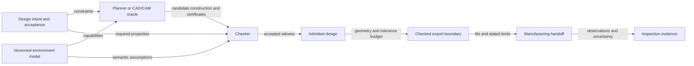

# Verified Design: shapes with manufacturing witnesses

**Version 0.1 — research sketch, 30 September 2026**

## Abstract

A verified CNC design library should admit a part only together with evidence for a way to make it. The evidence concerns a specific manufacturing environment: process, initial stock, tool geometry, material capabilities, workholding, machine motion, numerical error, and acceptance specification. This paper proposes representing designs through constructions that carry manufacturing witnesses. Geometry is a projection of the construction; an imported solid becomes an admitted design only after acquiring a checked plan. A small proof kernel checks certificates produced by potentially large, untrusted planners. Its soundness theorem is conditional on an explicit physical model and does not promise that a mathematical proof prevents tool breakage or establishes material properties. A simple pocket illustrates the contract. The proposal contains no implementation, machine instructions, or completed Lean proof.

## 1. Three different meanings of constructible

Classical Euclidean constructibility asks what can be constructed from given data using ideal straightedge and compass operations. CAD validity asks whether a representation denotes a well-formed object under a chosen geometry model. Manufacturing constructibility asks whether an available sequence of operations can produce an acceptable part. These predicates have different domains and neither of the first two supplies the third.

A geometrically valid pocket with a sharp inside corner cannot be produced exactly by the restricted operation of sweeping a positive-radius cylindrical end mill through that corner. A perfectly ordinary solid can require an inaccessible tool orientation. An ideal length can be approximated to a practical tolerance whether or not it belongs to the chosen classical construction field. Conversely, an exactly represented rational length can require a tolerance the equipment cannot establish. These are examples about specified process models, rather than universal impossibility claims about all manufacturing methods.

The relevant slogan is therefore:

> Every admitted design carries a manufacturing witness relative to its declared environment and acceptance contract.

“Admitted” matters. A user may explore arbitrary geometry. The library can render candidates, explain missing obligations, and search for a plan. It must reserve the status of admitted design for values whose witnesses have passed the appropriate checks. This distinction gives the design interface useful freedom without diluting its guarantee.

## 2. The environment and the acceptance contract

Let **E** contain the following model components, including their versions and units.

| Component | Required meaning |
| --- | --- |
| Process grammar | Available operations, their preconditions, allowed parameters, and state transitions |
| Stock | Initial occupied volume, dimensional uncertainty, provenance, and allowed variability |
| Tools and assemblies | Cutting regions, noncutting envelopes, dimensional uncertainty, wear assumptions, and tool identity |
| Material capability | Conditional restrictions on engagement, force, heat, chip evacuation, surface effects, and process settings |
| Fixtures and setups | Obstacle volumes, intended contacts, restraint assumptions, datum establishment, and transfer uncertainty |
| Machine | Forward kinematics, joint limits, admissible trajectories, interpolation semantics, and tracking bounds |
| Numeric semantics | Exact values, rounded representations, interval enclosures, and conversion rules |
| Inspection | Observable features, instrument uncertainty, registration, and acceptance decision rules |

These are semantic inputs rather than a collection of descriptive labels. “Aluminum” alone does not specify a material capability relation. “Three axes” alone does not identify a workspace, holder clearance, or controller behavior. LinuxCNC's own documentation distinguishes Cartesian axes from physical joints and their kinematic transformations, which motivates keeping both in the model. [LinuxCNC kinematics](https://linuxcnc.org/docs/stable/html/motion/kinematics.html)

A design **D** contains a nominal geometry **G**, a feature/datum specification, and an acceptance predicate **A** over a finished physical state. **A** need not be equality with **G**: it can require bounded dimensional deviations, feature location, fit, connectivity, residual thickness, burr limits, or finish. Geometry alone does not express all these requirements. A Hausdorff-distance bound, for example, can miss a small extra hole that changes topology or function; feature preservation requires additional obligations.

The environment must also assert that its initial-state assumptions are realizable. An empty set of admissible executions would make a universal conformance statement vacuously true. A usable witness must establish feasible initialization and completion for each admitted initial state, as well as conformance of every modeled completion. Probabilistic models would require a separately stated reliability contract; a probability estimate must not silently substitute for a universal statement.

## 3. Manufacturing witnesses

A witness **W** comprises a finite plan, state-transition certificates, geometric certificates, tolerance allocation, and the identities of any external attestations on which it depends. The evolving state contains remaining stock, installed tool assembly, fixture configuration, coordinate transforms, process settings, and retained or detached pieces. A setup change is an operation with preconditions and a transfer error, not a free rotation of a CAD object.

At each operation, the checker establishes that the required tool is available, the operation is permitted for the material model, the moving assembly is reachable, and the resulting state follows the operation semantics. It distinguishes intentional cutting contact from forbidden holder or fixture collision. A subtractive operation removes a specified swept cutting region from current stock; it cannot claim to create material that was never present. Releasing a part has its own support and retrieval obligations.

For a deterministic ideal model, one can write **Sᵢ₊₁ = Sᵢ ∖ Rᵢ**, where **Rᵢ** is the swept cutting region. A physical uncertainty model instead relates a set of possible initial stocks to a set of possible outcomes. The checker may use inner and outer stock/removal bounds, but must preserve the directions of those bounds and any required correlations. Inflating removed volume is useful for detecting overcut; it cannot also be used as evidence that all required material has been removed.

The target theorem is a contract:

**If** a witness checks under E and D, and a physical execution conforms to E's initialization, operation, and observation assumptions, **then** it completes within the modeled constraints and its finished state satisfies A.

This includes two bridges: the checker to the model, and the physical run to the model. Only the first is a conventional theorem about a program. Calibration, tool identity, restraint, and capability bounds must support the second. Stating them as hypotheses is honest; calling them proved without evidence is not.

## 4. Constructions before arbitrary solids

The primary interface should build a plan and its denotation together. A constructor for a capsule pocket consumes a stock/setup state, a tool, dimensions, and evidence of its preconditions. It returns the next state plus an admissible construction. A sequence constructor composes compatible transitions. The visible solid is obtained by evaluating these operations, so the manufacturing history remains available after rendering or export.

There are two practical presentation choices. Intrinsic syntax can make an invalid transition unrepresentable by indexing each step by its input and output state. A checked syntax tree can instead admit exploratory expressions and provide smart constructors or a certificate checker that produce a sealed admitted value. Both can preserve the same acceptance boundary. The decisive issue is that callers cannot mint an admitted value by attaching an unchecked boolean or self-authored geometry description.

This interface must not pretend all ordinary CAD operations preserve manufacturability. The union of two independently manufacturable solids need not be manufacturable under one setup. Scaling a witnessed part can invalidate tool-radius or force assumptions. A new hole can destroy fixture support. A rigid transform of the mathematical object need not correspond to a reachable setup. Such operations return candidates or require new compatibility and transition evidence.

An imported B-rep or mesh is therefore an input to planning. If a checked plan produces a state satisfying its intended acceptance specification, it may be promoted. Provenance should bind the certificate to the geometry, environment, tool library, tolerances, and exporter versions. Hashes help prevent stale-certificate reuse but do not prove those inputs correct.

## 5. A small checkable core and large planners

Separate candidate generation from certificate checking.



The planner can use optimization, geometric algebra, collision software, CAM, or learned heuristics. It may be wrong or incomplete. The checker accepts only the evidence language it understands. Failure to find a certificate is a useful diagnostic, not a theorem that the part is impossible.

Possible certificate families include rational orientation/intersection checks, cover-by-box separation bounds, exact sweep identities for selected primitives, interval bounds for continuous motion, and independently checked kinematic trajectories. A finite set of sampled positions cannot establish collision freedom between samples without a proved motion bound. A certificate for the cutter alone cannot establish clearance of the holder, spindle, fixture, or newly detached stock.

An external answer has three possible statuses: a proposal that a checker validates; a certificate whose interpretation and checker are proved; or an explicit trusted attestation. A raw “collision free” boolean from an external engine belongs to the third category until stronger evidence is available. Julia agreement tests, simulation output, and screenshots can catch mistakes but cannot become manufacturing theorems by renaming them certificates.

Lean is a plausible host for a small formal specification and checker soundness proofs. The design should expose which declarations are assumed, which are proved, which executable calculations have refinement proofs, and which empirical claims remain external. Adding a dependent type or a field called `proof` does not itself discharge any obligation.

## 6. Exact geometry and bounded approximation

Start with an exact specification fragment: rational coordinates, boxes, disks or algebraic circles where needed, finite unions, and explicitly supported sweeps. Do not assume rational inputs imply rational intersections or exact finite polygonal offsets. The representation must either support the needed extensions or return certified enclosures.

Use exact predicates for topological decisions where practical. Floating computations may guide search or supply fast filters, followed by checked exact or interval results. CGAL's manual distinguishes predicates from constructions and explains how rounding can make geometric decisions inconsistent. That distinction motivates separate certificates for deciding a relation and producing the points or curves used afterward. It is not an assertion that calling CGAL makes this proposal verified. [CGAL geometry kernel manual](https://doc.cgal.org/latest/Kernel_23/index.html)

An approximation is a relation with an error bound: a rendered mesh, exported curve, or evaluated pose must be linked to its semantic object. Display tessellation should not decide an unbounded-clearance question. A mesh can be appropriate for a conservative obstacle enclosure if enclosure is established; otherwise it is merely a visualization.

Manufacturing tolerance is a budget over that chain. Modeling, export rounding, controller interpolation, registration, tracking, tool size/wear, and material effects require compatible units and a stated combination rule. A worst-case sum can be conservative under appropriate bounded-error assumptions. Root-sum-square requires a statistical justification and yields a different kind of claim. Numerical exactness eliminates a source of computational uncertainty; it does not eliminate physical uncertainty.

## 7. Motion, stock, and physical capability

A geometric tool-center path needs a joint-space realization, an admissible time parameterization, and a correspondence to the complete assembly pose. Reachable endpoints do not imply a reachable path. Kinematic singularities, joint limits, velocity/acceleration restrictions, and clearance must be addressed over the entire motion. For multi-axis machinery, the witness records an actual branch-consistent joint trajectory rather than only a sequence of inverse-kinematics solutions.

The stock model must be updated after each cut. An obstacle can disappear after removal; a support can disappear too. Accessibility changes over time. A detached slug may become a moving obstacle unless the process model supplies retention or controlled removal. Fixturing requires more than nonintersection: the setup must restrain the workpiece through the operation under the admitted loads.

A cutter sweep is a geometry theorem under an ideal cutting model. Whether real cutting follows it depends on force, deflection, chatter, wear, heat, and chip evacuation assumptions. A practical early system can treat a validated process capability table as a trusted input and keep its provenance visible. A more ambitious system could formalize aspects of mechanics and uncertainty. Neither option justifies an unrestricted claim of safe operation.

Finally, export is part of the trusted chain. A certified geometric trace does not automatically certify a postprocessor or a controller. A later implementation would need a semantics for the particular output dialect, a refinement argument, and execution constraints. NIST's RS274/NGC report specifies an interpreter and its relation to canonical machining functions, illustrating the kind of semantic boundary that must be identified. This repository emits no such instructions. [NIST RS274/NGC interpreter report](https://www.nist.gov/publications/nist-rs274ngc-interpreter-version-3)

## 8. Tolerance and inspection

The acceptance predicate should refer to named features in declared datums, rather than a single global “epsilon.” A pocket width, hole position, flatness, and finish may require different observations and different models. The plan carries an allocation of achievable error for each required property and enough residual margin for the chosen inspection rule.

An observation is accompanied by an uncertainty interval or another explicitly stated measurement model. Under a bounded-interval model, accept a feature only when the entire possible true-value interval falls within its allowed interval. A measured number inside tolerance with an uncertainty interval crossing the boundary yields unresolved evidence. An instrument report does not by itself establish a calibration or registration hypothesis.

Separate planned conformance from inspected conformance. The first derives from a witness and capability assumptions; the second derives from observations and metrology assumptions. A supplier quote or upload acceptance establishes neither. The [toy case](docs/TOY-CASE.md) makes the distinction concrete with a conservative error budget.

## 9. Minimal type sketch

The following is illustrative Lean-like notation. `Environment`, `DesignIntent`, `Plan`, `Certificates`, and the semantic predicates are deliberately unspecified. This block is not compiled code or a promise that these obligations are inhabited.

```lean
structure AdmittedDesign (E : Environment) where
  intent : DesignIntent
  plan : Plan E
  certificates : Certificates E intent plan
  valid : WitnessValid E intent plan certificates

check : (E : Environment) → (D : DesignIntent) → (p : Plan E) →
  Certificates E D p → CheckResult E D p

checker_sound : check E D p c = .accepted h →
  ModelRealizable E → ModelExecutable E p ∧
  (∀ run, ConformsToModel E p run → MeetsAcceptance D run.final)
```

`ModelExecutable` must quantify over admitted initial states and rule out dead ends under the model's allowed choices. `WitnessValid` must actually imply the soundness target; placing an arbitrary proposition in its definition would make the interface empty or circular. An abstract existence proof may justify a mathematical design, but an executable-library value must additionally retain an inspectable finite plan and its refinement evidence.

## 10. Soundness and completeness

The most useful first guarantee is soundness of a small supported fragment: every accepted witness has the stated modeled meaning. It is acceptable for a checker to return **unknown** when an enclosure is too coarse, a certificate is unsupported, or a trusted capability is missing. Rejecting a proposed plan differs from rejecting all plans for a shape.

Completeness must name its search space. A finite enumeration of discretized, bounded plans with decidable checks can be complete for that finite candidate set. It says nothing about plans with different setups or continuous parameters. An enumeration of all finite encodings with a total exact validator can semi-decide witness existence in its grammar: valid encodings are eventually found, while nonexistence need not terminate. Interval tests that can remain unresolved do not automatically supply that exact validator.

For a continuously parameterized fragment, positive clearance and tolerance margins may help justify a resolution-complete search, but that is a separate theorem requiring coverage and continuity hypotheses. Arbitrary free-form surfaces, unrestricted programs, physical uncertainty, and unbounded process choices should not be bundled into a claim of a general machining decision procedure. This paper makes no undecidability or completeness theorem about manufacturing as a whole.

The library should be constructively useful without promising universal coverage: every admitted object has a witness, while many feasible real parts may remain outside its grammar. A library of carefully chosen operations can expand the admitted class through new sound constructors.

## 11. Grassmann as algebraic context

Michael Reed's Grassmann.jl provides geometric-algebra operations over parameterized spaces. Its public documentation includes exterior and geometric products, duality-related operators, and projective/conformal representations. These are plausible tools for expressing frames, transformations, incidence, orientation, and some geometric queries. [Grassmann.jl documentation](https://grassmann.crucialflow.com/dev/), [Reed's project description](https://crucialflow.com/)

The proposed Lean architecture would keep such an algebra layer separate from the manufacturing state machine. An adapter would prove that the chosen algebraic representation denotes the intended Euclidean entities and that supported operations refine the geometric specification. Then a manufacturing checker would establish access, collision, removal, support, and tolerance facts. An algebraic identity does not supply those facts on its own. Coordinate singularities and metric assumptions must remain explicit.

This paper imports no Grassmann source, proposes no automatic theorem reuse, and reports no build or correctness audit of a Lean port. The original Julia project's AGPL-3.0 license remains separate from the licenses of this original prose and plugin scaffold. The reported CNC motivation is not treated as a verified historical claim; [the context note](docs/GRASSMANN.md) records the evidence limit.

## 12. A bounded supplier handoff

SendCutSend is a useful boundary case because its public guidance exposes service-specific file and feature restrictions. File preparation and commercial acceptance are different from having an inspected machine-level witness. Its sheet-cutting guide also explains that material and thickness influence process selection. A certificate for one process therefore cannot silently apply to whatever process a supplier later selects. [SendCutSend sheet-cutting guidance](https://sendcutsend.com/guidelines/sheet-cutting/)

The [integration note](docs/SENDCUTSEND.md) records the public workflows found during this research. No supported public API specification was located; this is a discovery limit, not proof that no private or partner interface exists. The bundled plugin reads official guidance and produces an evidence-labeled handoff. It does not connect an account, upload designs, quote prices, place orders, or claim vendor approval.

## 13. Research agenda and falsifiable milestones

1. **Specify the first fragment.** Pick one tool model, one subtractive operation family, one setup model, and feature-specific acceptance. State every physical hypothesis. Demonstrate a nonempty admitted class.
2. **Prove sweep and composition laws.** Establish the toy operation's denotation, monotone stock removal, preserved invariants, and sound sequential composition. Include support loss and overcut counterexamples.
3. **Build a certificate checker.** Prove acceptance soundness for the actual executable checker. Use exact rationals and conservative enclosures, with an explicit unknown result.
4. **Connect numeric and motion representations.** Prove conversion bounds and continuous collision certificates; test adversarial near-tangent and near-singular cases.
5. **Check the export boundary.** Identify a supported format/dialect and its semantics before claiming executable handoff correctness. Bind certificates to exact emitted content.
6. **Connect to physical evidence.** Obtain documented capability and metrology evidence for a specific setup. Compare predicted and measured bounds; preserve failed observations rather than widening claims after the fact.

An appropriate first success is a small family of admitted designs with checked model witnesses and transparent assumptions. Publishing this architecture does not establish any of the future milestones. The companion [counterexamples](docs/COUNTEREXAMPLES.md) are requirements against which those milestones should be judged.

## References and evidence

The [source register](docs/SOURCES.md) identifies the primary references and what each supports. Mathematical definitions, proposed architecture, and the toy environment in this paper are original modeling choices. Supplier guidance can change; the review date is 30 September 2026.
